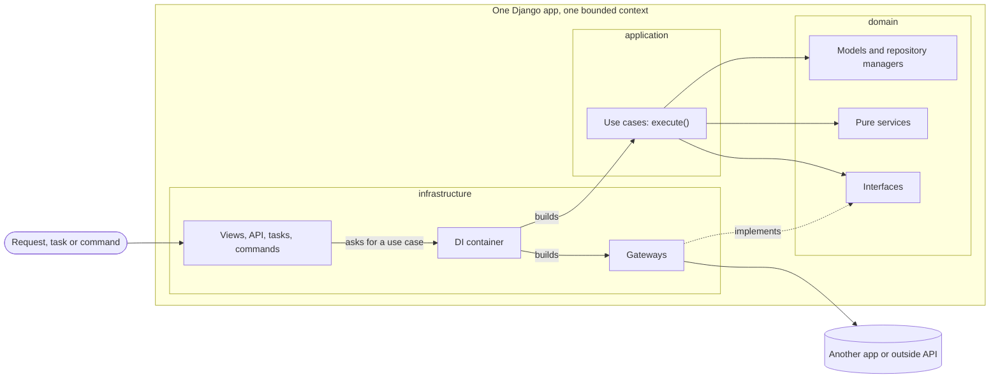

# django-ddd

A Claude Code plugin that teaches Claude to build Django projects as bounded contexts with domain, application and infrastructure layers, and stops it when an import breaks the layering.

It assumes Django and Django REST Framework. For everything else (test runner, formatter, task queue, frontend library) it uses what the project already has.

## The architecture

Each Django app is one bounded context with three layers. Imports point inward only.



Solid arrows are calls and imports, and they only point inward: infrastructure to application to domain. A use case reaches the outside world through an interface that a gateway implements.

| Layer | Holds |
|---|---|
| `domain/` | Models, repository managers, value objects, pure services, errors, interfaces, business constants |
| `application/` | One use case class per action, with a single `execute()` |
| `infrastructure/` | Views, API, admin, forms, tasks, commands, templates, gateways, the DI container |

An app never imports another app outside its gateways. Queries are built on repository managers, not in views or use cases. The clock is passed into use cases as an argument. The ORM is accepted as the persistence layer, so Django models are the entities.

## App layout

```
<apps root>/
├── corelib/                 small helpers with no business meaning
│   └── external/            HTTP clients for outside APIs
└── <app>/
    ├── __init__.py          points Django at infrastructure/apps.py
    ├── CLAUDE.md            what the code cannot tell you
    ├── domain/
    │   ├── models.py        Django models: the entities
    │   ├── managers.py      repositories: QuerySets and <Model>Repository managers
    │   ├── choices.py       TextChoices
    │   ├── exceptions.py    domain errors, each with a stable `code`
    │   ├── interfaces.py    ABCs for other apps and the outside world
    │   ├── settings.py      business numbers, with the reason for each
    │   ├── types.py         value objects and frozen dataclasses
    │   ├── services/        pure business logic, one class per file
    │   └── tests/
    ├── application/
    │   ├── use_cases/       one class per action, one public execute()
    │   └── tests/
    └── infrastructure/
        ├── apps.py          AppConfig
        ├── admin.py         model admins
        ├── di.py            the container that builds use cases
        ├── gateways.py      implementations of domain interfaces
        ├── views.py         class-based views and fragment endpoints
        ├── api.py           DRF views
        ├── serializers.py   DRF serializers
        ├── forms.py
        ├── tasks.py         background tasks
        ├── urls.py
        ├── management/      management commands
        ├── migrations/
        ├── templates/<app>/
        └── tests/
```

The apps root is whichever directory holds your Django apps. `init` finds it and records it. An app only has the files it needs.

There is no `repositories/` folder. A repository is a Django manager named `<Model>Repository` in `domain/managers.py`, attached to its model as `repository`. Use cases call `Loan.repository.open_count_for_member(member_id=...)`. It holds the reads and the writes that touch many rows or depend on a condition. When the file grows too long to scan, it becomes a `managers/` package with one module per model.

The full rules and the reasons for them are in [skills/architecture/SKILL.md](skills/architecture/SKILL.md).

## Example project

[django-ddd-example](https://github.com/SilmarillionUA/django-ddd-example) is a small library app built this way, with a catalog and a lending context. Read it to see the layers, a cross-app gateway and the tests for each layer in real code.

## Install

```
/plugin marketplace add SilmarillionUA/django-ddd-claude-plugin
/plugin install django-ddd@django-ddd-claude-plugin
```

Then, inside your Django project:

```
/django-ddd:init
```

`init` reads the project and writes three things:

- `CLAUDE.md` with the rules and your project's own test, format and lint commands.
- `.claude/django-ddd.json`, which turns the hooks on for this project.
- Permission entries in `.claude/settings.json`.

It shows each change before writing. It installs nothing and moves no code.

## What you get

Skills:

| Skill | Use |
|---|---|
| `architecture` | The rules and their reasons |
| `ddd-feature` | Build a feature through all layers, in order |
| `new-app` | Scaffold a bounded context and wire it into settings |
| `new-model` | A model with its QuerySet and repository manager |
| `new-service` | A pure domain service |
| `new-usecase` | A use case with DI wiring and tests |
| `new-gateway` | A domain interface and its gateway |
| `new-view` | A class-based view that calls a use case |
| `fragment-endpoint` | An endpoint that returns a partial template |
| `new-form` | A form that checks input shape only |
| `new-task` | A background task that delegates to a use case |
| `new-admin` | A model admin |
| `init` | Set up a project |

Subagents: `ddd-reviewer` reviews a change against the rules. `test-writer` writes tests in the layer that owns the code.

Commands: `/django-ddd:check-architecture`, `/django-ddd:lint`, `/django-ddd:format`, `/django-ddd:review`.

Hooks, active only in a project that has `.claude/django-ddd.json`:

- After each edit, the layer guard checks the file's imports. A violation is sent back to Claude to fix.
- After each edit, the file is formatted with the commands you configured.
- Before each shell command, destructive ones are blocked (dropping a database, force-push, `git reset --hard`).

## What is enforced

Only import direction is enforced by a script: `domain/` and `application/` may not import outward or from another app. The other rules are instructions and review. Claude follows them from `CLAUDE.md` and the skills, and `ddd-reviewer` checks them by reading the code.

## Configuration

`.claude/django-ddd.json`:

```json
{
  "apps_root": "src/apps",
  "format_commands": {
    ".py": [[".venv/bin/python", "-m", "black", "--quiet", "{file}"]]
  }
}
```

- `apps_root`: the directory whose children are your apps, relative to the project root. It must be on `sys.path`, so apps import as `lending`, not `apps.lending`.
- `format_commands`: commands to run on an edited file, by file suffix. `{file}` stands for the file. Leave it empty for no formatting.

To run the layer check in CI, copy `hooks/ddd_layer_guard.py` into your repository and run it from the project root with `--all`. It reads the apps root from `.claude/django-ddd.json`, so commit that file too.

## Requirements

- Claude Code with plugin support.
- `python3` on `PATH`, for the hooks.
- `git`, for the reviewer.
